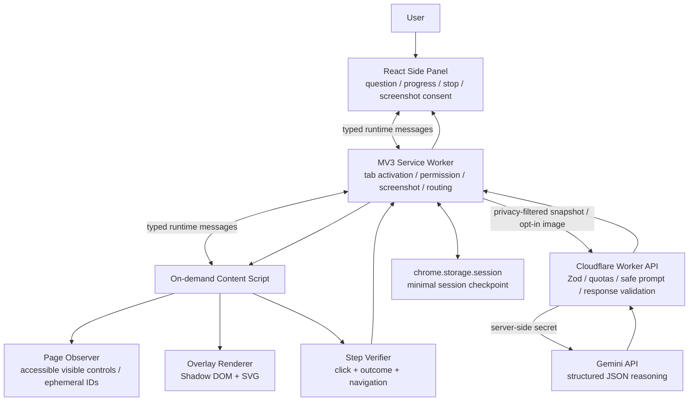

# ClickPilot — Production-minded, free-tier architecture

**Version:** 1.0  
**Date:** 20 October 2026  
**Scope:** Chrome-first browser extension for AI-powered, visual-only, step-by-step guidance.

> **Core contract:** ClickPilot may inspect the activated page, highlight and explain targets, and verify user actions. It must never autonomously click, type, submit, navigate, or retrieve secrets. It must never upload a screenshot without the user's explicit permission.

## 1. Executive design decisions

1. **DOM-first, vision-optional.** Ship DOM-only AI guidance before adding screenshots.
2. **One grounded step at a time.** A model selects a target from a supplied list of ephemeral IDs and proposes a verification condition. It never supplies executable code or authoritative CSS selectors.
3. **Chrome MV3 + WXT + React + TypeScript.** Side panel for the chat; service worker for events, permission checks and tab orchestration; on-demand page content script for observation and overlays.
4. **Cloudflare Worker with a tiny HTTP API.** Use Hono + Zod + direct Gemini REST or a lightweight provider adapter. No database, Redis, or Express server in the MVP.
5. **Free model selection is configurable.** Default to `gemini-2.5-flash` for text/image reasoning if the account has free-tier access; try `gemini-2.5-flash-lite` for cheap/fast DOM-only tasks. Verify availability and account-specific quotas in AI Studio before coding.
6. **Limit exposure.** The AI key lives only in Cloudflare Worker secrets. A hosted extension is public and can be reverse engineered; neither CORS nor an extension ID authenticates users. Budget caps, global shutdown and per-client/IP abuse controls are required.
7. **Minimal data retention.** Keep active session metadata in `chrome.storage.session`, preferences in `chrome.storage.local`, and do not persist page text or screenshots on the server.
8. **MVP boundaries.** Chrome desktop, top-level ordinary HTML/React pages, one active tab, one instruction at a time, three overlays (highlight, arrow, tooltip). No cross-origin iframes/canvas-only targeting in v1.

## 2. Architecture diagram



### Responsibility split

| Module | Must do | Must not do |
|---|---|---|
| React side panel | Ask question, consent, show progress, retry/stop | Read the website DOM directly |
| MV3 service worker | Route commands, enforce tab/page identity, capture opted-in screenshot, handle activation | Depend on in-memory state surviving suspension |
| Content script | Scan visible interactives, draw overlays, observe events and outcomes | Send unsanitized whole HTML or execute AI instructions |
| Worker backend | Check payload quotas, call model with JSON schema, validate returned target and action | Store screenshots / DOM text, expose model API key |
| Gemini | Choose **one** target ID and explain next user action | Browse, click, execute scripts, choose unseen selectors |

## 3. Reference stack and approximate cost

| Concern | Pick | Ongoing cash cost for personal/demo usage |
|---|---|---|
| Extension UI | WXT + React + TypeScript + Tailwind | Free |
| Messaging | `chrome.runtime` typed messages | Free |
| Page observation | DOM + ARIA + `getBoundingClientRect` | Free |
| Overlays | Shadow DOM + SVG/CSS | Free |
| State | `chrome.storage.session` and `.local` | Free |
| Backend | Cloudflare Workers Free + Hono | Free within plan limits (100k requests/day; 10ms CPU/request currently) |
| AI | Gemini API Free tier (`gemini-2.5-flash`, optionally Flash-Lite) | Free within account/model limits; not unlimited |
| Testing | Vitest + Playwright | Free locally / optional GitHub Actions free allowance |
| Storage/database | None | Free |
| Hosting dashboard | None needed; optional static landing page on GitHub Pages | Free |

**Watch-outs:** Cloudflare Workers' free 10ms CPU/request cap means the Worker should act as a lightweight gateway; network waits do not count toward CPU. Do not do heavy image parsing there. Free Gemini usage has account-specific RPM, TPM and RPD limits and free-tier data-handling conditions. Publishing in the Chrome Web Store may involve a developer registration fee; an unpacked extension costs nothing to distribute for testing.

**Hosted demo security:** A Worker URL shared by an extension is effectively public. A frontend hard-coded token, CORS allowlist, or extension-origin check does not prevent determined abuse. For a small public demo, combine request-size limits, global daily spend/usage cutoffs, IP-level throttling where supported, narrow allowed operations, and a kill switch. Avoid claiming strong per-user rate limiting without authenticated identities; use a self-hosted Worker option for wider distribution.

## 4. End-to-end request protocol

1. User clicks Chrome extension toolbar icon. This is the deliberate **activeTab** activation gesture. The extension opens its side panel and initializes/refreshes the selected tab context.
2. Background checks if scripting access exists and injects an idempotent content script on demand. If access is lost, show **Reactivate on this tab**, not a misleading success message.
3. User asks a question in the panel. `OBSERVE` request is sent to the content script with `sessionId`, `tabId`, `requestId` and a document-specific `pageKey`.
4. Observer collects at most ~100–150 relevant visible controls: role, safe short accessible name, normalized element type, bounding rectangle, visibility and disabled state. **Never** read input values, `contenteditable` content, cookies, tokens, headers or entire DOM HTML. Keep the `elementId -> Element` lookup in the content script only.
5. A privacy filter strips excessive page text, credentials/PII where detectable, and blocks excluded site categories. User is told what is being sent to the AI.
6. Background sends compact snapshot plus the user's task to `POST /v1/guidance/next` on the Cloudflare Worker. No screenshot by default.
7. Worker validates request size and schema, enforces quota/budget limits, calls Gemini with a constrained instruction and JSON response schema, validates returned action, and checks `targetId` belongs to the supplied list.
8. Background rejects a stale response if its tab/document/request identifier no longer matches the active session. Content script resolves the ephemeral ID **again**, validates DOM connectivity, visibility, hit testing and rectangle; if invalid, request a fresh snapshot (at most one automatic retry).
9. Content script renders SVG/CSS highlight, arrow and a tooltip anchored with viewport CSS pixel coordinates. Rendering uses text nodes/textContent, never interpolated HTML. `pointer-events: none` on decorative layers. Avoid drawing over the target.
10. After the user clicks, verifier observes `click` in the allowed target ancestry and checks the declared expected outcome (URL change, menu opening, expected control appearing, etc.). The click event itself is not completion. On success, request a **new** snapshot and next guidance step. If unable to confirm, show “I couldn't verify that step” with Retry/Continue manually.
11. Stop clears observers, overlays and volatile session data. Navigation / tab switching pauses or invalidates guidance if the target identity changes.

### Page and target identity

- `sessionId`: random UUID for a guided task.
- `tabId`: Chrome tab ID checked against active tab.
- `pageKey`: document lifetime token generated inside the content script, plus URL/path context. Changes after full navigation; watch SPA URL changes too.
- `snapshotId`: unique ID for one element list, **not** proof the page remains unchanged.
- `requestId`: monotonic request identifier. Latest result wins; superseded requests are dropped.
- `targetId`: ephemeral `el_###` in the in-page registry, valid only for its snapshot/document.
- Before each draw: `element.isConnected`, visibility, bounding rect, containment / obscuring checks, `pageKey` and `snapshotId` consistency.

## 5. API contracts

### Request (example; all page content is untrusted)

```json
{
  "protocolVersion": 1,
  "sessionId": "uuid",
  "requestId": "uuid",
  "page": {
    "url": "https://example.com/dashboard",
    "title": "Dashboard",
    "pageKey": "document-uuid",
    "snapshotId": "snapshot-uuid",
    "viewport": { "width": 1200, "height": 720 }
  },
  "userGoal": "Where do I change my settings?",
  "previousStepSummary": null,
  "elements": [
    {
      "id": "el_21",
      "role": "button",
      "name": "Settings",
      "disabled": false,
      "rect": { "x": 210, "y": 140, "width": 110, "height": 40 }
    }
  ],
  "capture": null
}
```

**Implementation detail:** Full URLs may contain sensitive query parameters. Strip query string and fragments by default (unless essential and explicitly permitted); an origin/path is generally enough. Redact page titles when potentially sensitive.

### Response

```json
{
  "protocolVersion": 1,
  "requestId": "uuid",
  "snapshotId": "snapshot-uuid",
  "kind": "highlight",
  "targetId": "el_21",
  "instruction": "Click Settings to open your preferences.",
  "reason": "That control leads to configuration options.",
  "expectedOutcome": {
    "type": "url_or_element_change"
  },
  "recoveryHint": "If the button is missing, refresh the guidance."
}
```

`kind` must be one of `highlight | ask_clarification | complete | unsupported`. `targetId` is permitted **only** for `highlight` and must match the request element inventory. Outcome validation should use a small **allowlisted** declarative vocabulary (not AI-generated JavaScript and not arbitrary selectors). In early iterations, the model may return a semantic expected outcome hint and the local verifier can fall back to user confirmation when objective proof isn't possible.

**Explicitly forbidden model output:** arbitrary JS, HTML, CSS selectors outside the supplied target IDs, fetch destinations, secrets, executable instructions, browser commands.

## 6. Targeting strategy (critical)

**Tier A — standard DOM:** semantic elements (`button`, `a`, controls, accessible clickable roles), labels, visible text, geometry. Filter detached, zero-size, offscreen or hidden controls. Keep a bounded element list. For duplicate “Settings” entries, include safe local context, such as dialog/landmark heading.

**Tier B — refresh:** after a mismatch or navigation, observe again and ask the model to choose from **new IDs**. Do not reuse stale rects.

**Tier C — opt-in vision (post-MVP):** if DOM-only reasoning fails, offer **Share this tab screenshot once**. Use `chrome.tabs.captureVisibleTab` for the active tab, hide the overlay temporarily, display a preview or otherwise provide informed consent, resize/compress locally and enforce payload bounds. Screenshot contents may expose private information, so block the default route for sensitive sites. Gemini can use an image plus the DOM inventory. Prefer returning an existing DOM ID.

**Tier D — visual-only coordinate target (stretch):** map image pixel positions back to CSS viewport coordinates with actual screenshot dimensions / viewport dimensions; account for device pixel ratio, zoom, scrolling and panel resizing. Only draw while page geometry remains unchanged. Do not claim click verification for an ungrounded coordinate. This tier is deliberately not in the MVP.

**Important:** A screenshot cannot safely be redacted merely by removing sensitive DOM input values from the text snapshot. Canvas editors, shadow DOM and cross-origin iframes are deliberately marked unsupported or limited in v1.

## 7. Guidance state machine

```mermaid
stateDiagram-v2
    [*] --> IDLE
    IDLE --> ACTIVATING: click extension icon
    ACTIVATING --> OBSERVING: tab permission granted
    ACTIVATING --> PAUSED: permission denied
    OBSERVING --> PLANNING: filtered snapshot ready
    PLANNING --> GUIDING: grounded response
    PLANNING --> RECOVERING: invalid target or rate limit
    GUIDING --> WAITING_FOR_USER: overlay rendered
    WAITING_FOR_USER --> VERIFYING: candidate action/page event
    VERIFYING --> OBSERVING: verified; next step
    VERIFYING --> RECOVERING: mismatch / timeout
    RECOVERING --> OBSERVING: retry
    RECOVERING --> PAUSED: user needs to intervene
    OBSERVING --> COMPLETED: objective achieved
    WAITING_FOR_USER --> STOPPED: stop
    PAUSED --> STOPPED: stop
    COMPLETED --> [*]
    STOPPED --> [*]
```



State owner: a pure TypeScript state-machine module, hosted in the side panel/session controller. Persist a compact checkpoint in `chrome.storage.session`, because the extension service worker is ephemeral. On restart, revalidate the tab/page and re-observe instead of replaying old targets. Cancel in-flight AI requests with `AbortController` when possible; always reject stale replies by identifier.

## 8. Chrome-specific engineering

- Required permissions initially: `activeTab`, `scripting`, `sidePanel`, `storage`; Worker HTTPS origin declared as a narrow host permission for extension fetches if required by your chosen networking design.
- Use `chrome.sidePanel.setPanelBehavior({ openPanelOnActionClick: true })`; toolbar action activation is also the reliable `activeTab` gesture. Clicking an in-panel button alone does not obtain a new `activeTab` grant.
- On cross-origin navigation, temporary `activeTab` access may expire. Do not silently request `<all_urls>`; show a reactivation flow. Later, optionally support per-site consent via `optional_host_permissions`.
- Chrome internal pages and protected browser surfaces have limitations; show “Not supported on this page.”
- Programmatic injection must be idempotent (don't duplicate listeners/overlay). Destroy everything on Stop, reload and tab change.
- Observe SPA URL changes, including history-API navigation (e.g., inspect `location.href` after user actions / periodic check while active), and regular navigation via Chrome tab updates. Don't assume `popstate` fires for `pushState`.
- The service worker cannot directly read the DOM and can go idle, so keep page-side observers in the content script and session checkpoints in storage.

## 9. Privacy and trust model

Threats: (a) untrusted website content attempts prompt injection; (b) model returns invalid/malicious output; (c) captured page contains private information; (d) public API endpoint is abused; (e) extensions collide with site CSS/JS; (f) cross-tab stale responses.

Controls:

- Treat webpage text as **data**, never system/developer instructions. Do not let it override permitted actions.
- Strong Zod schemas, length bounds, content filters, no tool execution, allowlisted return enum, target-ID membership checks.
- Ignore input values, hidden elements, tokens, secrets and full HTML; limit element names. Disable/ask confirmation for sensitive sites and screenshot sharing.
- Never persist screenshots on server; no request-body logging. HTTPS only; secrets in Worker environment, not extension assets.
- Shadow DOM for render isolation; use `textContent`, never `innerHTML` for AI strings. Overlay decorative layers use pointer-events none.
- Page-target identity validation before every draw, not just before model call.
- Publish clear privacy policy and user-data disclosure if distributing in Chrome Web Store.
- Gemini's *free tier* is documented as eligible for model-improvement data use; avoid sensitive customer information.

## 10. Folder structure (lean, scalable)

```text
clickpilot/
├── apps/
│   ├── extension/
│   │   ├── entrypoints/
│   │   │   ├── background.ts
│   │   │   ├── content.ts
│   │   │   └── sidepanel/{index.html,main.tsx}
│   │   └── src/
│   │       ├── features/session/{machine.ts,session-store.ts}
│   │       ├── features/observer/{collect-elements.ts,registry.ts,privacy.ts}
│   │       ├── features/overlay/{renderer.ts,positioner.ts,styles.css}
│   │       ├── features/verification/{verify-step.ts,events.ts}
│   │       ├── features/capture/{capture.ts}
│   │       ├── features/chat/{ChatPanel.tsx,StepProgress.tsx}
│   │       └── lib/{messages.ts,chrome-client.ts}
│   └── api/
│       ├── src/{index.ts,router.ts,provider/gemini.ts,security.ts}
│       └── wrangler.jsonc
├── packages/shared/src/{schemas.ts,types.ts,constants.ts}
├── tests/{fixtures,unit,e2e}
├── docs/{architecture.md,privacy-policy.md,test-matrix.md}
├── .github/workflows/ci.yml
└── pnpm-workspace.yaml
```

Avoid implementing every module in one pass. The folders describe final ownership; only create files when the first vertical slice needs them.

## 11. Milestones — vertical slices rather than disconnected weeks

### Phase 0: deterministic local prototype
- Build a tiny test website with Settings, Profile, navigation, modal and a fake multi-step form.
- Inject content script on toolbar click. Extract semantic controls with rects.
- In a debug-only panel, select an ID manually to draw accurate highlight, arrow and tooltip.
- **Acceptance:** 20 fixture interactions render without misalignment or blocked pointer events. No AI or backend yet.

### Phase 1: real AI → one highlight
- Build Worker `POST /v1/guidance/next`, Gemini adapter, shared Zod schemas.
- User asks question; backend selects an ID from compact DOM snapshot; local layer validates and highlights.
- Handle loading, rate limits, API errors and invalid target with clear UI.
- **Acceptance:** Task query leads to target on fixture pages with no screenshot and no autonomous action.

### Phase 2: verification and navigation
- Add guidance state machine, session checkpoints, click + outcome verification, navigation invalidation.
- **Acceptance:** Three-step workflow (settings → submenu → field) can be guided without stale overlays. Stopping cleans up all observers.

### Phase 3: robustness and consent
- Add filtering, permission-expiry UI, prompt injection test fixtures, local screenshot preview and optional screenshot branch.
- **Acceptance:** No screenshot uploaded without explicit approval; known sensitive pages refused by default; controlled failure when access expires.

### Phase 4: shipping and resume proof
- Add Chrome E2E tests, CI, 20–30 recorded test tasks on a small site matrix (fixtures, Wikipedia, GitHub, Vercel), test results table, README and demo video.
- **Acceptance targets (not claims):** ≥90% correct element selection on curated visible-control cases, ≥80% guided workflow completion; 0 unwanted clicks/typing; 0 pointer-blocking overlays; all failures explain recovery.
- If publishing publicly, complete privacy disclosure, kill switch, abuse controls and separate API project with limits. The Chrome Web Store may require a registration fee.

**Reasonable solo build target:** 4–8+ weeks depending on time availability and screenshot/permissions complexity. The first demonstrable end-to-end slice should come earlier.

## 12. Technical priorities for interviews

Be prepared to discuss:
- How DOM-grounded model output reduces hallucinations compared with coordinates.
- Why `activeTab` and optional host permissions beat blanket `<all_urls>` access.
- Why MV3 service workers force explicit checkpointing and revalidation.
- How you avoid prompt injection and page-content leakage.
- How you distinguish clicked targets from actually completed steps.
- Why free inference needs rate limiting, payload constraints and an abuse-aware backend.
- Benchmark methodology, failures and trade-offs (not made-up model accuracy).

Example resume bullet **after you have measured the data**:

> Built ClickPilot, a Chrome MV3 visual-guidance extension with React, TypeScript, Cloudflare Workers and Gemini; used DOM-grounded structured AI responses, Shadow DOM overlays and verified user-driven workflows. Achieved [measured result] across [number] test tasks; added privacy controls, schema validation and CI tests.

## 13. First Codex build prompt

> You are implementing ClickPilot Phase 0, a Chrome-first visual-only browser assistant. Read docs/architecture.md. Use WXT + React + TypeScript + pnpm workspace. Implement only extension toolbar activation, side panel, idempotent content-script injection, typed messaging, page interactive-element extraction (safe labels and bounding rectangles, no field values), a registry of ephemeral IDs, and SVG overlay for manually selected element ID. Use MV3 permissions `activeTab`, `scripting`, `sidePanel`, `storage`. Do not add backend, LLM, screenshot capture, database, authentication or automatic clicking. Handle Chrome restricted pages, navigation, re-injection and listener cleanup. Add a local test page and unit tests for element filtering/geometry. Run typecheck, lint and tests, and document loading as an unpacked extension. Implement the smallest working end-to-end vertical slice; do not invent future features.

## 14. Source references (verified October 2026)

- Chrome `activeTab`: https://developer.chrome.com/docs/extensions/get-started/tutorial/scripts-activetab
- Chrome scripting: https://developer.chrome.com/docs/extensions/reference/api/scripting
- Chrome side panel: https://developer.chrome.com/docs/extensions/reference/api/sidePanel
- Chrome MV3 service worker lifecycle: https://developer.chrome.com/docs/extensions/develop/concepts/service-workers/lifecycle
- Chrome optional permissions: https://developer.chrome.com/docs/extensions/reference/api/permissions
- Chrome screenshot capture: https://developer.chrome.com/docs/extensions/reference/api/tabs#method-captureVisibleTab
- WXT content scripts / Shadow DOM: https://wxt.dev/guide/essentials/content-scripts
- Gemini models and free pricing: https://ai.google.dev/gemini-api/docs/pricing
- Gemini API account-specific rate limits: https://ai.google.dev/gemini-api/docs/rate-limits
- Gemini structured JSON output: https://ai.google.dev/gemini-api/docs/structured-output
- Gemini image understanding: https://ai.google.dev/gemini-api/docs/image-understanding
- Cloudflare Worker Free limits: https://developers.cloudflare.com/workers/platform/limits/
- Chrome Web Store handling policy: https://developer.chrome.com/docs/webstore/user_data
